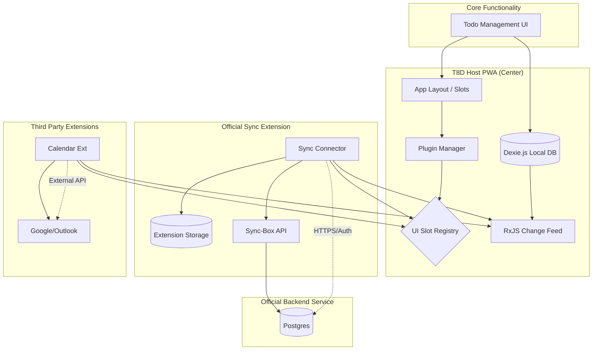

# Architecture: T8D v2.0.0

## 1. Executive Summary

T8D v2.0.0 is an extensible, offline-first task management platform. The core application (Host) acts as a "thin shell" providing the UI layout and a local database, while all advanced features—including cloud sync, authentication, and third-party integrations—are implemented as **Runtime Extensions**.

## 2. Project Structure

The repository is managed as a **pnpm monorepo**.

```text
/t8d-v2
  ├── /apps
  │   └── web              # The "Host" PWA (React + Vite + Tailwind)
  ├── /packages
  │   ├── sdk              # THE CONTRACT: Interfaces, PluginAPI, & RxJS Event Bus
  │   └── db               # Dexie.js configuration (The Local Source of Truth)
  ├── /extensions
  │   ├── official-sync    # Frontend bridge for Cloud Sync (The "Addon")
  │   └── [future-ext]     # e.g., google-calendar, pomodoro-timer
  ├── /services
  │   ├── sync-box         # Node/Prisma Backend for Official Sync
  │   └── [future-svc]     # Backends for specific complex extensions
  ├── package.json         # Workspace root
  └── pnpm-workspace.yaml

```

## 3. System Architecture Diagram



## 4. Component Definitions

### A. The Host (apps/web)

The PWA functions as an "Operating System".

- **Responsibility**: Rendering the main layout and managing "Slots" (e.g., `Sidebar.Bottom`, `TaskItem.Menu`).
- **Plugin Discovery**: Maintains a `plugins.json` manifest (local or remote) containing metadata and entryPoint URLs.
- **Plugin Loading**: Uses dynamic ESM `import()` to load extension entry points at runtime.

### B. The SDK (packages/sdk)

The "Shared Mental Context" and security boundary.

- **The API**: Handed to extensions via an `activate(api)` function.
- `api.db.onTaskChange()`: Stream of local updates for observation.
- `api.ui.registerComponent(slotId, component)`: Method to inject UI into Slots.
- `api.storage`: Private, namespaced Key-Value store for extension settings.

- **Permissions**: Extensions must declare required scopes (e.g., `DATA_READ`, `NOTIFICATIONS`) in their manifest.

### C. The Database (packages/db)

- **Technology**: **Dexie.js**.
- **Role**: The Single Source of Truth for the UI.
- **Events**: Emits reactive streams using RxJS, allowing extensions to "observe" data changes without being hardcoded into the CRUD logic.

### D. The Sync-Box (services/sync-box)

- **Technology**: Node.js, Prisma, PostgreSQL.
- **Role**: A thin API focused on receiving "Sync Envelopes" from the official extension, resolving conflicts via `lastModified` and `hash` fields, and persisting remote data.

## 5. Data Models (The Contract)

### Task

```typescript
export enum TaskStatus {
  NOT_COMPLETED = "not_completed",
  COMPLETED = "completed",
}

export interface Task {
  id: string;
  name: string;
  description?: string;
  status: TaskStatus;
  createdAt: number;
  lastModified: number;
  dueDate: number | null;
  listId: string;
  parentId: string | null;
  hash: string;
  order: number; // Float for fractional indexing
  metadata?: Record<string, string | number | boolean | string[] | null>;
  is_deleted?: boolean;
}
```

### TaskList

```typescript
export interface TaskList {
  id: string;
  name: string;
  description?: string;
  lastModified: number;
  hash: string;
  order: number;
  is_deleted?: boolean;
}
```

## 6. Data Flow: The Observer Pattern

Unlike v1, v2.0.0 uses a passive observer flow:

1. **User Action**: User marks a task as "Completed."
2. **Local Write**: The PWA writes the change to **Dexie**.
3. **Reactive Signal**: The DB emits a change event via the **SDK RxJS Bus**.
4. **Extension Reaction**: The **Sync Extension** hears the event, manages its own private outbox logic, and pushes it to the **Sync-Box Service**.
5. **Conflict Resolution**: The **Extension** (not the Host) is responsible for resolving conflicts when pulling from the server by comparing `lastModified` and `hash` before updating the Local DB.

## 7. Development Strategy (MVP)

- **Boundary**: Extensions never `import` from `apps/web`; they only communicate through the `api` object.
- **Isolation**: Third-party extensions requiring backend logic must house that code in `services/[extension-name]` to maintain microservice independence.
